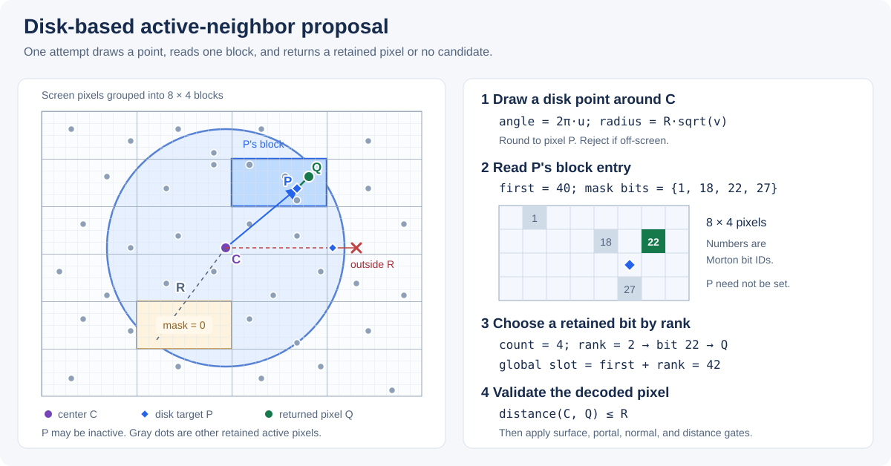

# RTXDI in Sparse Rendering 

Sparse rendering uses compact reservoirs and reuses reservoirs written by active
pixels. Temporal and spatial selection find compatible active neighbors before
the reuse passes load and merge their light samples. Initial sampling, reuse, and
final lighting remain sparse.

## Configuration

Enable sparse rendering with `rtx.sparseRendering.enableSparseRendering = True`.
DLSS Ray Reconstruction is required, and ReSTIR GI mode disables sparse rendering.
Compact reservoir storage follows sparse
rendering automatically. When sparse rendering is inactive, RTXDI uses its
dense storage and existing neighbor-selection path.

The uniform sampling rate is configured through `rtx.sparseRendering.samplingRate`.
Automatic rate scaling can change the effective rate with internal resolution.
Set `rtx.sparseRendering.enableAdaptiveSamplingRate = False` when a fixed rate is
needed for a comparison.

| Option | Meaning and default |
| --- | --- |
| `rtx.di.sparseNeighborCandidateCount` | Shared candidate budget, 1–128. Default 8. |
| `rtx.di.sparseTemporalNeighborCandidateCount` | Temporal fallback budget. Default 0 inherits the shared budget. Values 1–128 override it. |
| `rtx.di.sparseSpatialNeighborCandidateCount` | Spatial candidate budget. Default 0 inherits the shared budget. Values 1–128 override it. |
| `rtx.di.sparseTemporalNeighborSearchRadius` | Temporal fallback disk radius in render pixels, 1–128. Default 10. |
| `rtx.di.sparseSpatialNeighborSearchRadius` | Spatial disk radius in render pixels, 1–128. Default 50. |

These controls appear in the RTXDI GUI settings when sparse rendering is enabled.
Temporal and spatial reuse can still be enabled or disabled independently.

Candidate budgets limit search attempts. `rtx.di.spatialSamples` and
`rtx.di.disocclusionSamples` control the number of spatial reservoirs merged,
with defaults of two and four. Both are capped at four during sparse rendering.
The fixed limit `RTXDI_MAX_ACTIVE_NEIGHBORS` is shared by C++ and shaders through
`rtxdi/SparseNeighborSearchParameters.h`. Four 32-bit IDs occupy a 16-byte spatial
cache per allocated active slot. 

## Implementation

### Disk-based candidate search

Temporal selection and spatial selection use `RAB_GetActiveNeighborCandidate`.
The search uses the configured screen-space radius directly.



*The sampled point P can be inactive. Its block supplies a retained pixel Q.
The enlarged block shows four active bits in Morton order: rank 2 selects Q and
global compacted slot `first + 2`. Empty blocks and candidates outside the circle
consume an attempt without returning a neighbor. The layout and slot numbers are
illustrative.*

Each attempt proceeds as follows:

1. Check that the search center is on-screen. Temporal search also requires valid
   compacted history. A failed check returns no candidate before drawing randomness.
2. Draw one 32-bit proposal value. Its low 11 bits supply the angle fraction,
   the next 11 bits supply the radius fraction, and the top 10 bits select a rank
   inside the block:

   ```text
   angle  = 2*pi * low11 / 2048
   radius = R * sqrt(next11 / 2048)
   target = floor(center + radius * (cos(angle), sin(angle)) + 0.5)
   ```

   This is the uniform-area disk construction with quantized random inputs.
   An off-screen target consumes the attempt and returns no candidate.
3. Read the target's 8×4 block entry from the current or previous
   `BlockRankOffsets` table. It contains `first`, the first global compacted slot
   of that block, and `mask`, its retained active pixels. An empty mask consumes
   the attempt and returns no candidate.
4. Compute `count = countbits(mask)` and `rank = (top10 * count) >> 10`.
   Find the set bit at that rank and decode its Morton position inside the block.
   The candidate's global compacted index is `first + rank`.
5. Reject the decoded pixel when its distance from the search center exceeds `R`.
   Otherwise return the pixel and its global index. Surface compatibility is
   checked by the caller.

The spatial center is the current active pixel. The temporal center is the
reprojected previous-frame pixel, after optional permutation sampling. A successful
direct temporal reprojection bypasses the disk search entirely.

There are no retries inside an attempt. After the center checks, even an empty
block or failed distance test consumes one proposal random number and one attempt
from the budget. Weighted selection uses additional random draws of its own.

#### Block entries and addressing

Compaction writes one `uint2` entry per 8×4 screen block:

```text
entry.x = tile global base + retained active pixels before this block
entry.y = retained-pixel mask, using Morton bit positions inside the block
```

The retained pixels of a block occupy consecutive slots in mask order. The
`rank`-th set bit therefore identifies both the screen pixel and slot
`entry.x + rank`. If a tile exceeds its allocation, the mask contains only the
pixels retained by the scatter's proportional retention rule.

A proposal reads one block entry and decodes the pixel directly. It does not read
tile metadata or `ActivePixelCoords`. Current spatial merging later uses
`ActivePixelCoords` to recover the screen coordinates of cached global slots.
Temporal search decodes previous pixels from the previous block table, so no
previous-frame active-coordinate list is required.

### Temporal and spatial selection

Let `T` and `S` be the resolved temporal and spatial candidate budgets, and `N`
the spatial sample count for this pixel, capped at four.

| Stage | Procedure |
| --- | --- |
| Temporal | Test the exact reprojected pixel first. On failure, examine up to `T` disk proposals. Maintain one weighted selection and stop after encountering a score of at least 0.5. |
| Spatial | Examine up to `max(S, N)` disk proposals. Maintain `N` weighted selections and stop after `N` encounters with scores of at least 0.5. |

Direct temporal reprojection accepts a compatible active pixel immediately,
without evaluating a score. If that exact pixel is inactive, other active pixels
in its block do not make the exact lookup succeed. Fallback search can propose
those neighbors separately.

For a valid positive score `w`, weighted selection adds `w` to the running weight
sum and replaces the selected neighbor with probability `w / weightSum`.
Spatial slots use independent replacement draws with a shared weight sum.
Selection is with replacement: the same pixel can occupy multiple slots, and
the early-stop count does not require unique candidates. A candidate that triggers
early stopping is not necessarily the selected one.

Spatial selection obtains `N` from reprojection confidence. It averages a 3×3
confidence neighborhood and uses the disocclusion sample count while the derived
history length is below `rtx.di.disocclusionFrames`. Equal configured counts skip
the confidence read. 

### Compatibility score

The score combines shading-normal similarity with the distance between virtual
positions reconstructed from normalized camera rays and ray hit distances. It follows the paper Compatibility-Guided Neighbor Selection for ReSTIR [Junkins et al. 2026]:

```text
normalWeight = max(dot(nc, nn), 0)^8
sigma        = max(zc * sqrt(0.05 / pi), 1e-6)
centerPos    = zc * normalize(centerRay)
neighborRay  = centerRay + (pixelStep.x * dx, pixelStep.y * dy, 0)
neighborPos  = zn * normalize(neighborRay)
score        = normalWeight * exp(-length(neighborPos - centerPos) / sigma)
```

The symbols in these equations are:

| Symbol | Meaning |
| --- | --- |
| `nc` | Current surface's shading normal. |
| `nn` | Candidate surface's shading normal, from the current frame for spatial selection or the previous frame for temporal selection. |
| `zc` | Center ray hit distance: the current surface's hit distance for spatial selection, or `expectedPrevHitDistance` for temporal selection. |
| `zn` | Candidate surface's ray hit distance in the source frame. |
| `centerRay` | Unnormalized view-space camera ray through the scoring center, using the current camera for spatial selection or the previous camera for temporal selection. |
| `dx`, `dy` | Candidate pixel coordinates minus the scoring center's pixel coordinates. Temporal scoring uses the unpermuted `prevPixelCenter` as that center. |
| `pixelStep` | X/Y changes in the unnormalized view-space ray per render-pixel step, derived from the selected camera's inverse projection and render resolution. |

Hit distances are clamped to at least zero for reconstruction and the scoring
scale. Despite the helper name `RAB_GetSurfaceLinearDepth`, they are ray-path
distances rather than camera-space Z or hardware depth-buffer values.

Spatial scoring uses the current camera and center hit distance. Temporal scoring
uses the previous camera, the unpermuted `prevPixelCenter`, and
`expectedPrevHitDistance`. This compares candidates with the current surface's
expected virtual position in the previous view. That position need not have been
visible in the previous GBuffer. 

Before the score is computed, the default validity gate (binary rejection) checks each candidate's normal and hit distance, rejecting poor geometric matches while avoiding unnecessary score evaluations. Tests found no performance regression and a very small quality gain.

### Reservoir storage and history

Each reservoir is 32 bytes, packed as two `uint4` values. Its fields contain the
selected light's UV, weight sum, target PDF, light index, sample count `M`, portal
index, stable light identity, and frame stamp. Surface geometry is stored separately.

Compaction divides the screen into 256×128 tiles. Retained active pixels follow
Morton order within each tile, including clipped tiles. Each tile atomically
allocates one contiguous global run. Tile runs follow allocation order, so the
entire active list is not globally Morton sorted.

| Mapping | Contents |
| --- | --- |
| `CompactedPixelIndices` | R16 tile-local active rank for each screen pixel. `0xffff` means inactive. |
| `TileActiveCounts` | Retained active count in `.x`, global tile base in `.y`. |
| `ActivePixelCoords` | Current screen XY packed into one uint32 per global slot. |
| `BlockRankOffsets` | First global slot in `.x`, retained Morton mask in `.y`, per 8×4 block. |

An exact screen-pixel lookup is:

```text
tile           = pixel / (256, 128)
localRank      = CompactedPixelIndices[pixel]
globalSlot     = TileActiveCounts[tile].y + localRank
reservoirIndex = page * compactedStorageCapacity + globalSlot
byteAddress    = reservoirIndex * 32
```

The lookup rejects inactive ranks, invalid tile ranges, and indices outside the
allocated capacity. Known current launch indices use `RAB_LoadReservoirAtIndex`
to avoid that inverse-map lookup. Compacted GBuffer textures convert a global slot
to a texel in a 64×64 Morton square, separately from reservoir addressing.

Current and previous frames keep separate inverse maps, tile metadata, and block
tables because activity and allocation order can change each frame. The CPU sets
`rtxdiCompactedHistoryValid` only when the retained mapping belongs to the immediately
preceding device frame. History resets and recreated mappings invalidate it.

Reservoir stamps use `cb.frameIdx`. A write stores `frameIdx + 1`, a current read
expects `frameIdx + 1`, and a previous-frame read expects `frameIdx`. Zero or
mismatched stamps return an empty reservoir. These checks reject stale records
when an active background pixel skipped the write. The constant-buffer frame index
also follows RNG seed controls, so freezing the frame seed affects these stamps
and gradient-page parity.

`RAB_IsPreviousPixelActive` checks mapping activity without reading a reservoir.
`RAB_IsReservoirAvailable` additionally checks the current record's stamp. A written
reservoir with a legitimately rejected light is still available. Off-pixel indirect
sample stealing and diffusion-profile sampling use this distinction to choose their
existing fallback when the projected pixel has no available current reservoir.

When RTXDI gradient resources are not allocated, page 0 holds history and page 1
is scratch. With gradient resources, pages 0 and 1 alternate as history and page 2
is scratch. The two-page layout is typical with DLSS Ray Reconstruction, but also
applies when RTXDI gradients are disabled.

Initial sampling and temporal reuse write scratch, and spatial reuse writes the
final history page. Transmission PSR shares scratch before initial sampling and
requires dense-pixel addressing:

```text
bufferBytes = 32 * (H * C + max(C, D))

H = persistent history pages: 1 without RTXDI gradient resources, 2 with them
C = allocated compacted capacity, including headroom
D = dense pixel capacity, padded to complete 16×16 blocks

reservoir offset = page * C + globalSlot
PSR offset       = H * C + densePixelIndex
```

The dense scratch requirement limits memory savings. Previous mappings, block
tables, selection caches, and the guide are additional allocations.

Allocation checks selection-buffer range and shader-index limits when choosing
the compact layout. Failure returns a zero-capacity layout and disables sparse
rendering, rather than combining sparse launches with dense reservoir storage.
